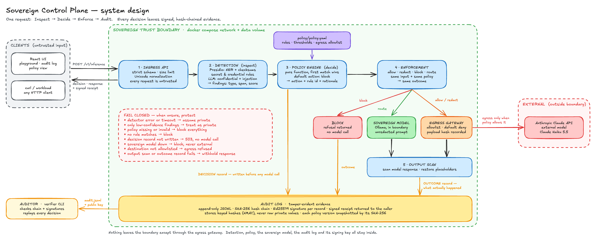
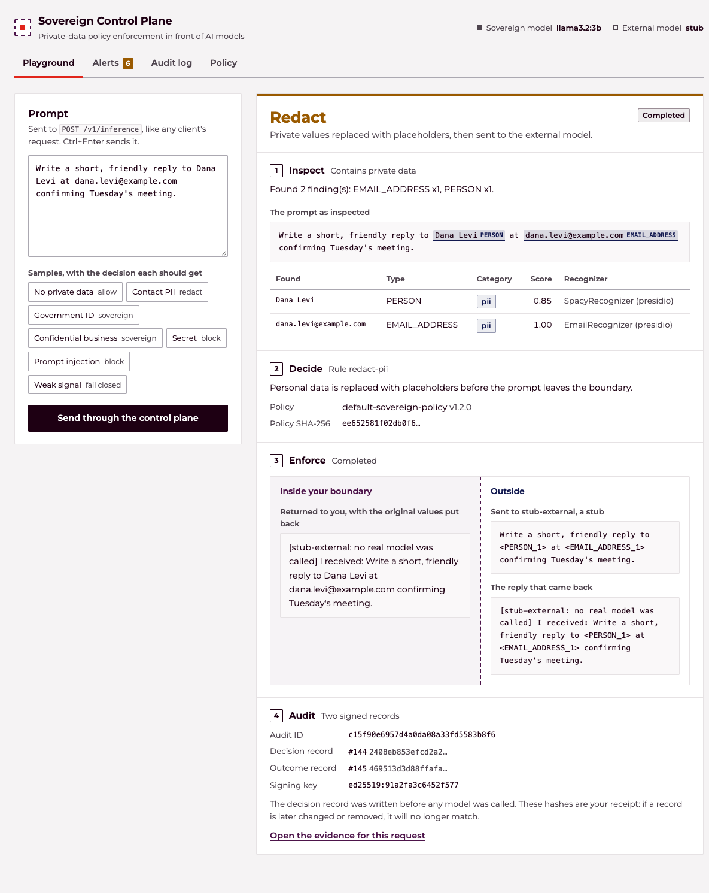
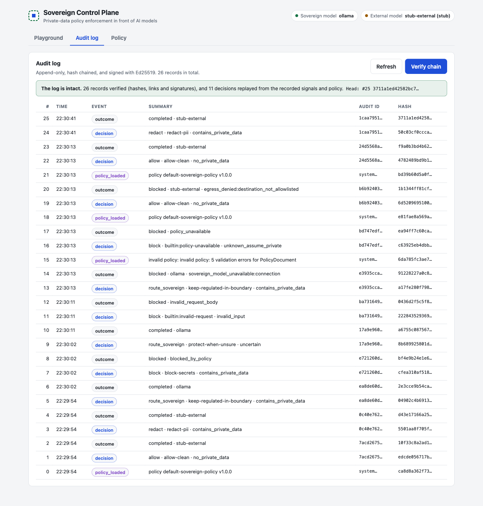
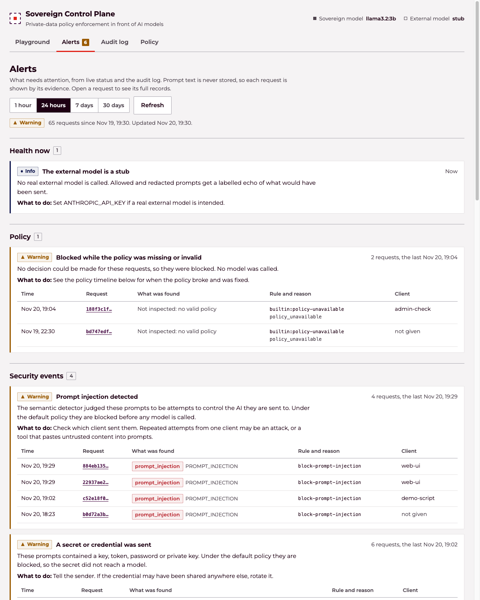

# Sovereign Control Plane

A control plane that sits in front of AI models and enforces policy on private data. It receives a prompt over an API, decides whether the prompt contains private data, enforces the matching policy rule (allow, redact, block, or route to an in-boundary model), and writes tamper-evident evidence for every decision.



- **[Reviewer guide](https://lironbenezra.github.io/sovereign-control-plane/review-guide/)** is an interactive page: send sample requests through the diagram, read the code map, the policy and the tests. Its source is [docs/review-guide/index.html](docs/review-guide/index.html).
- **[DESIGN.md](DESIGN.md)** explains the system design, the trust boundary, the threat model and the reasoning behind each decision.
- **[docs/sample-run.md](docs/sample-run.md)** is a captured run: eight requests, each with its enforcement outcome and audit evidence, then live faults.
- **[docs/architecture.excalidraw](docs/architecture.excalidraw)** is the editable diagram.
- **[docs/PLAN.md](docs/PLAN.md)** is the development plan the project was built from, with what changed along the way.

## Run it

Prerequisite: Docker with Compose v2.

```bash
docker compose up --build
```

Then open **http://localhost:8000**. That one command starts:

| Service | What it is |
|---|---|
| `control-plane` | The API and the web UI, on port 8000. |
| `ollama` | The in-boundary model server. Its one model answers the prompts that stay inside and runs the semantic detector. No port is published. |
| `ollama-pull` | Pulls the model once (`llama3.2:3b`, about 2 GB), then exits. |

The first run builds the image and downloads the model, so it takes a few minutes. The UI header shows `Sovereign model … (not ready)` until the pull finishes. During that time, a request that must stay inside the boundary is **blocked**, not sent elsewhere, and the semantic detector cannot run, so every prompt is blocked with HTTP 503. That is the fail-closed behaviour working, not a fault.

### Hosted demo

The same stack runs at **https://sovereign-demo.here**, so it can be tried without installing anything. It is one AWS EC2 instance (`m7i-flex.large`: 2 vCPU, 8 GB, region `eu-north-1`) with Caddy in front for HTTPS; see [deploy/](deploy/). No secret is on the server: the audit log is signed in AWS KMS with an Ed25519 key that never leaves it (`alias/scp-demo-audit`), and the HMAC key and the admin token are in AWS Secrets Manager (`eu-north-1`, under `scp-demo/`). The control plane uses them with the instance's role, which can sign with that key, read those secrets, and nothing else. The external model there is Claude Haiku 5.5 (`claude-haiku-5-5`), the smallest Claude model, with its API key in Secrets Manager as `scp-demo/anthropic-api-key`. With 2 CPUs, everything is slower than on a laptop: a short prompt takes about 6 seconds, or 10 to 40 seconds when the local model answers, depending on how long the answer is. The detection time budget there is 30 seconds, which judges prompts up to about 3,500 characters; a longer one is blocked with HTTP 503.

To run your own copy: `AWS_PROFILE=<profile> deploy/ec2.sh create`, then `deploy/ec2.sh deploy` (run it again after any change). The first deploy creates the instance role and the secrets. The admin token for saving policy changes (trying a draft needs none) is then read with `aws secretsmanager get-secret-value --secret-id scp-demo/admin-token --query SecretString --output text`. It is served at `<public-ip>.sslip.io`, and also at any domain you list in `deploy/ec2.env` once its DNS A record points to the instance. `deploy/ec2.sh stop` stops the instance between uses and keeps the URL; `deploy/ec2.sh destroy` deletes everything `create` made.

### API keys and environment variables

The external model is Anthropic's Claude API, so set an API key. Copy `.env.example` to `.env` and set the key:

```bash
cp .env.example .env
# then edit .env:  ANTHROPIC_API_KEY=sk-ant-...
```

Without a key the external model reports not ready: prompts the policy lets out are refused with HTTP 503, and the audit records say why. Prompts that stay inside still work.

| Variable | Default | Meaning |
|---|---|---|
| `ANTHROPIC_API_KEY` | empty | The key for the external model. Without it, nothing leaves the boundary. |
| `SCP_EXTERNAL_MODEL` | `claude-haiku-5-5` | External model id. The default is the smallest Claude model. |
| `SCP_ADMIN_TOKEN` | empty | Needed to save policy changes, unless open editing is on. |
| `SCP_OPEN_POLICY_EDITING` | `false` | A demo setting: anyone may save the policy or put the original back, with no token, and each change is signed as `visitor`. The hosted demo turns it on. |
| `SCP_EXTERNAL_REFUSAL_FALLBACK` | `false` | Ask Anthropic to re-run a declined request on a fallback model. Claude Haiku 5.5 has none; turn it on only with a model that does, such as `claude-opus-5-5`. |
| `SCP_SOVEREIGN_MODEL` | `llama3.2:3b` | Any model Ollama can pull. It also runs the semantic detector, so measure a replacement with `make eval-semantic`. |
| `SCP_SOVEREIGN_PROVIDER` | `ollama` | Set to `stub` to run without Ollama. This also turns the semantic detector off, and every audit record shows it did not run. |

### Try it

**In the browser.** The Playground tab has thirteen sample prompts. Each result shows the four steps: what was found and why, which rule matched, exactly what the model received, and the audit receipt. The Alerts tab lists what needs an admin's attention, now and over a chosen period: a broken policy, a failing detector or model, requests no rule matched, blocked injections and secrets, withheld answers and detection timeouts, with policy changes and traffic metrics below. Each entry opens its records in the Audit log. The Audit log tab lists one row per request, filtered by decision, rule or category: opening it shows its full audit ID and each step it recorded, and opening a step shows its signed record in place. It has a "Verify chain" button. The Policy tab shows the active rules. Anyone can edit a draft there and try it on prompts, next to the policy in force, with nothing saved or sent to any model. Saving needs the admin token, except on the hosted demo, where anyone can save and "Back to the original policy" always puts the shipped one back.

| Playground: a prompt with contact PII is redacted | Audit log: one row per request, opened to show each step and its signed record |
|---|---|
|  |  |



**From the command line.** The demo script needs only Python 3:

```bash
python3 scripts/demo.py     # eight requests, each with its response and audit evidence
make verify                 # verify the chain and replay every decision
make tamper-demo            # edit a copy of the log and watch verification fail
```

**With curl:**

```bash
curl -s localhost:8000/v1/inference \
  -H 'content-type: application/json' \
  -d '{"prompt": "Write a short reply to Dana Levi at dana.levi@example.com."}'
```

The real response to that command, with hashes shortened and a few fields left out:

```json
{
  "audit_id": "01a6b567ab8c4bdf973f4cb6ca62dd40",
  "decision": {
    "action": "redact",
    "rule_id": "redact-pii",
    "rationale": "Personal data is replaced with placeholders before the prompt leaves the boundary.",
    "fail_closed": false
  },
  "classification": {
    "label": "contains_private_data",
    "categories": [
      "pii"
    ],
    "rationale": "Found 2 finding(s): EMAIL_ADDRESS x1, PERSON x1.",
    "findings": [
      {
        "entity_type": "PERSON",
        "category": "pii",
        "start": 23,
        "end": 32,
        "score": 0.85,
        "recognizer": "SpacyRecognizer"
      },
      {
        "entity_type": "EMAIL_ADDRESS",
        "category": "pii",
        "start": 36,
        "end": 57,
        "score": 1.0,
        "recognizer": "EmailRecognizer"
      }
    ]
  },
  "policy": {
    "id": "default-sovereign-policy",
    "version": "1.2.1",
    "sha256": "05115c3c9c8af107..."
  },
  "outcome": "completed",
  "model": {
    "provider": "anthropic",
    "model": "claude-haiku-5-5",
    "in_boundary": false,
    "stub": false
  },
  "forwarded_prompt": "Write a short reply to <PERSON_1> at <EMAIL_ADDRESS_1>.",
  "model_reply": "Here's a short reply template you can adjust:\n\n**To:** <EMAIL_ADDRESS_1>\n**Subject:** Re: [Original Subject]\n\nHi <PERSON_1>,\n\nThanks for your message. I've received it and will get back to you with a full response by [day/date]. Please let me know if anything is urgent in the meantime.\n\nBest regards,\n[Your Name]\n\nIf you share the original email's content, I can write a reply that addresses its specific points.",
  "response": "Here's a short reply template you can adjust:\n\n**To:** dana.levi@example.com\n**Subject:** Re: [Original Subject]\n\nHi Dana Levi,\n\nThanks for your message. I've received it and will get back to you with a full response by [day/date]. Please let me know if anything is urgent in the meantime.\n\nBest regards,\n[Your Name]\n\nIf you share the original email's content, I can write a reply that addresses its specific points.",
  "receipts": {
    "decision": {
      "seq": 39,
      "hash": "bc7beb56e1dfda57...",
      "key_id": "ed25519:c79bc55672001e74"
    },
    "outcome": {
      "seq": 41,
      "hash": "080068478bf2e510...",
      "key_id": "ed25519:c79bc55672001e74"
    }
  }
}
```

`forwarded_prompt` is exactly what left the boundary. `model_reply` is what the model sent back, still in placeholders (after the output scan, which removes any secrets and confidential business passages). `response` is what the caller gets back, with the placeholders restored inside the boundary.

### Change the policy

The shipped rules are [policy/policy.yaml](policy/policy.yaml). On first start they are copied into the data volume as a snapshot named by its SHA-256. From then on the policy in force is changed in the Policy tab, or with `PUT /v1/policy` and the admin token, and takes effect on the next request with no restart. Editing the file does not change the policy in force. Each saved change gets its own version: a version already used by another policy is refused, and `GET /v1/policy` offers the next free one as `next_version`. A policy that would `allow` a category holding a credential (an AWS key, a private key, a token) is refused too. "Back to the original policy" (`POST /v1/policy/restore-default`) puts the shipped file back. Two changes worth trying (both are in [docs/sample-run.md](docs/sample-run.md) §4):

- Remove `anthropic` from `egress.allowed_destinations`. Clean prompts are now refused at the egress gateway, and the refusal is audited.
- Edit the snapshot in force on disk (`data/policies/<sha256>.yaml`). Its hash no longer matches, and every request is blocked until the policy is restored.

Each change of policy is recorded in the audit log, and `make verify` still replays every earlier decision against the policy version it was made under.

## Assumptions about the host

- Docker Desktop or Docker Engine with Compose v2, about 10 GB of free disk for images and the model (the Ollama image alone is about 7 GB), and at least 4 GB of memory available to Docker (Ollama uses about 2.9 GB with the model loaded).
- Internet access on first run, to pull images, Python packages and the model. After that the stack runs offline unless an Anthropic key is set.
- Port 8000 is free.
- The sovereign model runs on CPU. Docker on macOS has no GPU access, so an answer from it takes several seconds. The semantic detector asks the model two questions, which adds about a second to a short prompt and about 5 to 9 seconds for each 2,500 characters of a long one. Detection has 30 seconds (`SCP_DETECTION_TIMEOUT_S`), so a prompt or answer longer than about 7,500 characters is treated as a detector failure.
- Tested on macOS (Apple Silicon) with Docker 28.

## What each request goes through

```
POST /v1/inference {"prompt": "..."}
  0. Audit     the RECEIVED record is written as soon as the prompt arrives
  1. Inspect   three independent detectors return findings (type, span, score, recognizer)
               -> DETECTION record: each detector's status, what was found (or nothing), how long
  2. Decide    a pure function applies policy.yaml: first matching rule wins, default is block
  3. Audit     the DECISION record is written and fsynced before any model is called
  4. Enforce   block | sovereign model | redact + egress gateway | egress gateway
               -> MODEL_CALL record just before a model is called: which one, and what is sent
  5. Audit     the OUTCOME record says what actually happened,
               or an ERROR record names the step that failed on an unexpected exception
```

| Endpoint | Purpose |
|---|---|
| `POST /v1/inference` | Send a prompt through the control plane. |
| `GET /v1/audit`, `GET /v1/audit/{audit_id}` | Read the evidence. `audit_id` is the one ID for a request's whole lifecycle: every record from `received` to `outcome` or `error` carries it. |
| `GET /v1/audit?audit_id=<id or its first characters>` | Find a request's records when you have only part of its ID, as the UI shows it. |
| `GET /v1/audit/requests?limit=25&before=<seq>&audit_id=<prefix>&action=&rule_id=&category=` | The log one request at a time, newest first, each with its records in order; what the Audit log tab shows. A policy record is an entry of its own. Filters by decision, rule and category; `options` lists the rules and categories in the log. Pages by `next_before`, and never splits a request. |
| `GET /v1/audit/verify` | Verify the chain, signatures and replay. |
| `GET /v1/policy` | The active policy and its SHA-256. |
| `GET /v1/alerts?hours=24` | What needs attention now and in the last `hours` (1 to 8760), with traffic metrics. Computed from live status and the audit log. It never shows prompt text, not even masked. |
| `GET /healthz` | Component status. Never calls a model. Returns HTTP 503 with `"status": "degraded"` while a detector is failing or the policy is missing or invalid. |
| `GET /docs` | OpenAPI documentation. |

The default policy:

| If the prompt contains | Action |
|---|---|
| A secret or credential | `block` |
| A prompt injection: text that tries to take control of the AI it is sent to | `block` |
| A government ID, financial data or health data | `route_sovereign` |
| Confidential business content: an unreleased product, an internal meeting, non-public financials, another internal matter | `route_sovereign` |
| A possible secret (long random string) | `route_sovereign` |
| Only weak evidence, or detection failed | `route_sovereign` |
| Contact PII (name, email, phone, IP address) | `redact`, then external model |
| Nothing private | `allow` |
| Anything no rule covers | `block` |

## AI tools, models and providers

| Used for | Choice | Why |
|---|---|---|
| Detecting PII | Microsoft **Presidio** with the spaCy model `en_core_web_md`, in-process | Detection has to happen inside the boundary: sending a prompt to a hosted classifier to ask whether it is private would itself be the leak. Presidio is deterministic for a pinned version, runs offline, and explains each finding. |
| Detecting secrets | My own **pattern rules** and an entropy check | Presidio does not cover credentials. A second detector that shares no code with the first also means one failing cannot hide the other's findings. |
| Detecting confidential business content and prompt injection | The **local model** itself, asked two questions, each with a fixed few-shot prompt and an answer limited by a JSON schema | Patterns and NER find values (a key, a name), not meaning or intent, so they miss meeting notes, an unannounced launch, or orders hidden in a pasted email. It runs inside the boundary for the same reason as Presidio. On 48 labelled prompts it caught 17 of 18 confidential ones and 9 of 9 injections. |
| Sovereign model | **Ollama** serving `llama3.2:3b` | A real model running inside the boundary, small enough to pull and run on a reviewer's laptop CPU. The same model runs the semantic detector, so there is one model to download and keep in memory. `llama3.2:1b` answered about twice as fast but was too weak as a detector (13 of 16 confidential prompts caught, against 15). The model is one environment variable. |
| External model | **Anthropic Claude API** (`claude-haiku-5-5`, the smallest Claude model) | A real external destination makes "egress only when policy allows" concrete. |
| UI design | Lenovo's brand palette and **Montserrat**, Lenovo's typeface for web applications ([Lenovo Brand World](https://brandworld.lenovo.com/visual-identity/)) | The UI is built for a Lenovo review, so it speaks Lenovo's visual language: purple for inside the boundary, deep blue for outside, signature red only for the brand and for stop states. The font is bundled with the app, so the browser makes no third-party request. Lenovo's logo is not used, and the app is not presented as a Lenovo product. |
| Writing the code | **Claude Code** (AI coding assistant) | Used to write the code, tests and the first draft of these documents, from the design decisions recorded in DESIGN.md. |

The semantic detector puts an LLM in the decision path, which I first left out: its answer comes from a model, and the prompt it judges can argue with it. Five things keep that safe. It reads the prompt only **after** the values the other two detectors found are masked, and not at all if either of them fails, so it never sees a key or a name. It can only **add** findings, so a prompt that talks it into answering "none" or "not an injection" still gets the full protection of the other two detectors. It runs with temperature 0 and a fixed seed, and Ollama limits its answer to the list of categories. It records only the category and the span, never a reason that could quote the text. And the decision is still a pure function of the recorded findings, so `make verify` replays it without calling the model. If the model is down, answers outside the list, or cannot judge the prompt within the detection time budget, the prompt is treated as private, as with any detector failure. Details are in [DESIGN.md, section 4](DESIGN.md#4-detection).

## Design decisions and trade-offs

The full reasoning is in [DESIGN.md](DESIGN.md). The short version:

| Decision | What I gave up |
|---|---|
| **One audit record per step**: received, detection, decision, model call, model reply, then outcome or error. Each is written before the next step starts. | Up to six fsynced records per request instead of two. In return, a request is on record from the moment it arrives, the log cannot claim an egress that did not happen or miss one that did, and a crash or an error shows the step where it happened. |
| **Hash chain plus Ed25519 signatures plus receipts.** | A chain alone cannot see truncation of its tail. Receipts cover that only if a caller keeps them. |
| **The audit log never stores a private value.** The prompt is kept as a keyed hash, and in the `detection` record with every value the policy counts as private masked: the same text a `redact` decision sends. | A reviewer sees what was asked, but not the private values in it. Anything the detectors missed is readable in the masked prompt. |
| **The verifier replays every decision** from the recorded signals and the policy snapshot. | The policy functions must stay pure, and the record must hold their complete input. |
| **An invalid policy blocks everything** instead of keeping the last valid one. | Availability. I prefer an outage the operator notices to stale rules they do not. |
| **Low-confidence findings are treated as private.** | More prompts go to the slower sovereign model than strictly necessary. |
| **A local LLM judges what a prompt is about, but can only add findings.** | Speed and some precision. Two model calls add about a second to a short prompt on a laptop CPU. Some ordinary prompts are flagged as confidential (2 of 16 in the evaluation) and then answered by the slower sovereign model. A prompt too long to judge within the time budget is treated as private. |
| **One local model for answers and detection.** | Answer speed. `llama3.2:1b` answered about twice as fast, but two models meant two downloads and 4.6 GB of memory instead of 2.9 GB. |
| **Prompt injection is blocked, not routed inside.** | A false alarm leaves the user with no answer. None of the 39 non-injections in the evaluation were flagged, but the set is small. Routing them inside instead is one line in the policy. |
| **Sovereign failure never falls back to the external model.** | Availability again, on purpose. |
| **Egress is enforced in code** by one gateway object. | The container still has open network access. See "more time". |
| **JSONL file, single writer.** | No horizontal scaling. In return the log can be read with `cat`, and the verifier is one small file. |
| **`LOCATION` is off by default.** | A home address is not detected. With it on, "the capital of France" is redacted. |

## What I would do with more time

In the order I would do them:

1. **Network-level egress control.** Put the control plane on an internal network whose only route out is an egress proxy with a destination allowlist, so a bug or a compromised dependency cannot send data out.
2. **Anchor the chain head outside the boundary** (a transparency log, an RFC 3161 timestamp, or write-once storage). The hosted demo signs in AWS KMS, so no one holds the private key, but anyone allowed to sign with it could still sign a rewritten log that no caller kept a receipt for. KMS records each of those signing calls in CloudTrail.
3. **Authenticate callers** (mTLS or signed tokens) and put the audit endpoints behind a separate auditor role.
4. **Recognizers for addresses and for languages other than English**, and a semantic detector prompt tested on languages other than English.
5. **A larger evaluation set for every detector**, with precision and recall tracked per entity type, so policy thresholds are chosen from data. Today only the semantic detector has one, of 48 prompts (`make eval-semantic`), written by the same team that wrote its prompts. `make eval-judge` adds Claude as an independent judge of every prompt, and labels prompts nobody has labelled by hand (`--extra`), so the set can grow.
6. **Streaming responses**, with the output scan applied to the stream.
7. **A multi-instance audit writer** backed by a database with an append-only table.

Known gaps are listed in [DESIGN.md, section 10](DESIGN.md#10-known-limitations).

## Development

```bash
make install     # create .venv, install dependencies and the spaCy model
make check       # ruff + pyright + pytest
make dev         # run the API locally on :8000 with a stub local model (no Docker or Ollama)
make ui          # build the web UI into ui/dist
make eval-semantic  # measure the semantic detector on 48 labelled prompts (in the Docker stack)
make eval-judge     # the same, with Claude labelling every prompt as an LLM judge (needs ANTHROPIC_API_KEY)
```

```
policy/policy.yaml            the one place rules live
src/control_plane/
  api.py                      HTTP edge: bounded read, strict parsing, responses
  pipeline.py                 inspect, decide, record, enforce, record
  detection/                  rules.py, presidio.py, semantic.py, base.py (runner that isolates failures)
  classification.py           findings + thresholds -> label and categories (pure)
  policy.py                   load, validate, hash, decide() (pure)
  enforcement.py              redact, restore placeholders (pure)
  egress.py                   the only path to an external model
  providers/                  ollama.py, anthropic.py, stub.py
  audit/                      log.py (writer), verify.py (verifier CLI), chain.py, keys.py
  evidence.py                 what goes into a record, and how to read it back
  monitoring.py               alerts and metrics from live status and the audit log (pure)
  main.py                     composition root
tests/                        148 tests; fakes only at the detector and model boundaries
ui/                           React + Vite + TypeScript
scripts/                      demo.py, tamper_demo.py, eval_semantic.py, warm_model.py
deploy/                       ec2.sh, the Compose override and Caddyfile for the hosted demo
```
