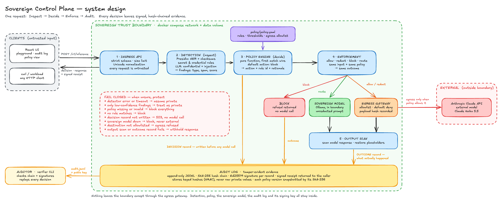

# Development plan

This is the plan the control plane was built from. It was agreed on 2026-11-19, before any code was written, and updated on 2026-11-20 to match what was built. [Section 11](#11-changes-from-the-original-plan) lists every place where the build differs from the original plan.

- **[DESIGN.md](../DESIGN.md)** explains the design in depth.
- **[README.md](../README.md)** explains how to run it.

## 1. Context

The Lenovo Hybrid Cloud home assignment asks for a sovereign control plane in front of an AI workload. It receives a prompt over an API, decides whether the prompt contains private data, enforces a configurable policy (allow, redact, block, or route to a sovereign model), and writes tamper-evident evidence for every decision.

Three rules from the assignment shaped this plan:

- The design explanation is weighted as heavily as the code.
- Time is capped at about 10 hours, and "a small system that genuinely enforces and audits beats a large one that only sketches it".
- Evidence must not be fabricated: it must reflect decisions the system actually made.

On top of the assignment, the project includes a web UI that talks to the endpoint, and a system diagram drawn before any code.

## 2. Decisions

| Question | Choice | Why |
|---|---|---|
| How is private data detected? | Microsoft Presidio, plus a separate set of pattern rules for secrets | Detection has to run inside the boundary: asking a cloud classifier whether a prompt is private would send the prompt out. Presidio is deterministic, works offline, and explains each finding. |
| What is the sovereign model? | Ollama in Docker Compose, serving `llama3.2:1b` | A real model inside the boundary that still starts with one command. A labelled stub can be selected by configuration. |
| What is the external model? | Anthropic Claude API | A real external destination makes "egress only when policy allows" concrete. |
| What is the UI built with? | React, Vite and TypeScript, built inside Docker and served by the API | One origin and one command. Good enough to highlight findings and browse the audit chain. |

## 3. Assumptions

- The project lives in its own git repository, with a commit per milestone.
- `docker compose up --build` is the single command. The API and UI are on http://localhost:8000, and Ollama runs as a second service.
- The backend uses Python 3.11 and FastAPI. Local development uses `pip` and `venv`.
- The repository starts with the Python quality starter `CLAUDE.md`, and with Ruff, Pyright and pytest set up before any code is written.

## 4. Architecture

The editable diagram is [architecture.excalidraw](architecture.excalidraw).



```
 Clients (untrusted)                 SOVEREIGN TRUST BOUNDARY (Compose network + data volume)
 ┌─────────────┐  POST /v1/inference  ┌────────────────────────────────────────────────────────────┐
 │ React UI    │ ───────────────────▶ │ 1 Ingress API      strict schema, size limit, normalize    │
 │ curl / app  │ ◀─────────────────── │        │                                                   │
 └─────────────┘  decision + receipt  │ 2 Detection        Presidio (NER + checksums) + rules      │
                                      │        │ findings: type, span, score, recognizer           │
                                      │ 3 Policy engine    pure function  ◀── policy/policy.yaml   │
                                      │        │ action + rule id + rationale                      │
                                      │ 4 Audit: DECISION record (written before any model call)   │
                                      │        │                                                   │
                                      │ 5 Enforcement ── block ───▶ refusal, no model call         │
                                      │        ├── route ─────────▶ Sovereign model (Ollama)       │
                                      │        └── allow / redact ▶ Egress gateway (allowlist) ────┼──▶ Anthropic API
                                      │ 6 Output scan ▶ Audit: OUTCOME record ▶ response           │     (external)
                                      │                                                            │
                                      │ Audit log: append-only JSONL, hash chain, Ed25519 signed   │
                                      └────────────────────────────────────────────────────────────┘
                                         ▲ Verifier CLI (auditor): checks chain + signatures, replays decisions
```

## 5. How each requirement is met

| Requirement | Mechanism |
|---|---|
| 1. Prompt in through an API | `POST /v1/inference`. Unknown fields are rejected, the body size is capped, and Unicode is normalized (NFKC, invisible characters removed). Rejected requests are audited too. |
| 2. A clear private-data decision | Every finding carries its entity type, category, character span, score and the recognizer that fired. The classification has a label, the categories found and a rationale sentence. All of it is in the response and in the evidence. |
| 3. Deterministic, configurable enforcement | One file, `policy/policy.yaml`, holds the entity-to-category map, score thresholds, ordered rules (first match wins), the default action `block`, and the egress allowlist. `decide(classification, policy)` is a pure function: no clock, no randomness, no model. |
| 4. Tamper-evident audit evidence | Append-only JSONL. Each record holds `prev_hash`, its own SHA-256 over canonical JSON, and an Ed25519 signature. The API returns a receipt (sequence number, hash, signature) so a caller can later prove a record existed. A standalone verifier checks the chain and replays each decision. |
| 5. Fail closed | See [section 7](#7-fail-closed-behaviour). |
| 6. Stay sovereign | One egress gateway is the only code path to an external model. It sends only when the rule's action is `allow` or `redact` and the destination is on the policy's allowlist. Every egress is recorded with its destination and payload hash. |
| 7. Explain the design | `README.md`, `DESIGN.md` (trust boundary, threat model, trade-offs), the diagram, and a captured sample run. |

## 6. Evidence design

- **Two records per request, linked by `audit_id`.** The decision record holds the signals, classification, policy id, version and SHA-256, the matched rule, the action and the rationale. It is written and fsynced *before* any model is called. The outcome record holds what was actually sent where, the provider, whether it is a stub, the payload hash, the response length and the output scan. It is written *after*. The log therefore never claims an egress that did not happen, and a decision with no outcome is visible as an interrupted request.
- **No raw private values in the log.** The prompt is stored as a keyed hash (HMAC-SHA256), because a plain hash of a short prompt such as an SSN or a phone number can be reversed by trying every value. Findings are recorded by type, position and score, never by value.
- **Every policy version is kept.** Each version is saved as `data/policies/<sha256>.yaml`. The verifier re-runs classification and `decide()` on the recorded signals with the saved policy, and confirms the recorded action. That is how a decision is reconstructed from the evidence alone, and it also shows the decision is deterministic.

## 7. Fail-closed behaviour

| Failure | Outcome |
|---|---|
| A detector raises or times out | Classified `unknown_assume_private`; never sent outside. |
| Only low-confidence findings | Classified `uncertain`; treated as private. |
| Policy file missing or invalid | Every request blocked until it is fixed. The caller gets HTTP 503 and a message saying so, and `/healthz` reports `degraded`. Stale rules are not silently kept. |
| No rule matches | `block` (default deny). |
| The decision record cannot be written | HTTP 503, no model call. |
| The sovereign model is down or not ready | `block`. Never falls back to the external model. |
| The destination is not on the egress allowlist | Egress refused and audited. |
| The output scan or the outcome record fails | Response withheld. |
| A model provider raises an error it does not document | Recorded as a failed call that was attempted. |

Each row has a test; [DESIGN.md section 8](../DESIGN.md#8-fail-closed-behaviour) names them.

## 8. Default policy

| If the prompt contains | Action |
|---|---|
| A secret or credential | `block` |
| A prompt injection (found by the semantic detector) | `block` |
| A government ID, financial data or health data | `route_sovereign` |
| Confidential business content (found by the semantic detector) | `route_sovereign` |
| A possible secret (long random string) | `route_sovereign` |
| Only weak evidence, or detection failed | `route_sovereign` |
| Contact PII (name, email, phone, IP address) | `redact`, send to the external model, restore placeholders in the answer inside the boundary |
| Nothing private | `allow` |
| Anything no rule covers | `block` |

## 9. Project layout

```
sovereign-control-plane/
  CLAUDE.md  README.md  DESIGN.md  Makefile  pyproject.toml  .env.example
  Dockerfile  docker-compose.yml              control plane + UI, Ollama, one-off model pull
  policy/policy.yaml                          the one place rules live
  docs/
    PLAN.md                                   this file
    architecture.excalidraw  architecture.png
    sample-run.md                             captured output, not edited
    ui-playground.png  ui-audit.png  ui-alerts.png
  src/control_plane/
    main.py            composition root
    config.py          settings from environment variables
    api.py             routes, request and response schemas, bounded body read
    pipeline.py        inspect, decide, record, enforce, record
    models.py          Finding, Signals, Classification, Decision
    classification.py  findings + thresholds -> label and categories (pure)
    policy.py          load, validate, hash, decide() (pure)
    enforcement.py     redact, restore placeholders (pure)
    egress.py          the only path to an external model
    evidence.py        what goes into a record, and how to read it back
    monitoring.py      alerts and metrics from live status and the audit log (pure)
    detection/         base.py (runner that isolates failures), rules.py, presidio.py, semantic.py
    providers/         base.py, ollama.py, anthropic.py, stub.py
    audit/             chain.py, keys.py, log.py (writer), verify.py (verifier CLI)
  tests/               one file per module, plus test_presidio_integration.py
  scripts/             demo.py, tamper_demo.py, eval_semantic.py, warm_model.py
  ui/                  React + Vite + TypeScript
```

The code is a deterministic pipeline. The only abstractions are at the two boundaries that really have more than one implementation: detectors and model providers. There are no service or repository layers.

## 10. Milestones

| # | Milestone | Estimate (h) | Status |
|---|---|---|---|
| 0 | Excalidraw diagram, then scaffold: git, starter `CLAUDE.md`, pyproject, Ruff, Pyright, pytest, Makefile | 0.75 | Done |
| 1 | Thin end-to-end slice with stubs: API, secret rules, policy, audit chain, response | 1.5 | Done |
| 2 | Detection depth: Presidio, entity-to-category map, thresholds, `uncertain` handling | 1.25 | Done |
| 3 | Audit hardening: Ed25519 signatures, receipts, verifier CLI, replay, tamper demo | 1.5 | Done |
| 4 | Real enforcement: redaction and placeholder restore, Ollama provider, Anthropic provider behind the egress gateway, output scan | 1.75 | Done |
| 5 | Fail-closed tests by fault injection, one per row of section 7 | 0.75 | Done |
| 6 | UI: playground with highlighted findings, audit log with "Verify chain", read-only policy view | 1.75 | Done |
| 7 | Compose packaging, captured sample run, `README.md`, `DESIGN.md` | 1.25 | Done |

The total estimate was about 10.5 hours. If time had run short, the plan was to drop, in this order: the UI policy view, placeholder restore in responses, and the output scan. None of them had to be dropped.

## 11. Changes from the original plan

| Area | Original plan | What was built | Why |
|---|---|---|---|
| Detection | Presidio and secret rules | Also a rule for health terms and a check for long random strings, both scored in the "uncertain" band | Presidio has no health-context or credential detection. Scoring them as uncertain keeps such prompts inside the boundary without blocking them. |
| Default policy | `LOCATION` counted as PII | `LOCATION` left out | The NER model tags every country and city, so "What is the capital of France?" was being redacted. It is one line in the policy to turn back on. |
| Default policy | Five rules | A sixth rule sends possible secrets to the sovereign model | Follows from the random-string check above. |
| Policy | Every rule fully configurable | One fixed rule: if detection failed, nothing may leave the boundary, whatever the policy says | Redaction depends on detection, so after a detection failure neither `redact` nor `allow` can be trusted. |
| Fail closed | Eight cases | A ninth: an undocumented provider error is recorded as an attempted call | Without it, such an error would have left a decision with no outcome record. |
| Layout | `detection/secrets.py`, `detection/classify.py` | `detection/rules.py`, `classification.py`, plus `config.py`, `evidence.py`, `audit/chain.py`, `audit/keys.py`, `providers/base.py` | Classification is not detection, and the evidence format is shared by the writer and the verifier. |
| Demo | `scripts/demo.sh` | `scripts/demo.py`, using only the Python standard library | Easier to print each request next to the audit records it produced. |
| Audit location in Docker | `./data` on the host | A Docker volume. `make verify` and `make tamper-demo` run inside the container; `LOCAL=1` runs them against `./data` | The container runs as an unprivileged user, and a volume avoids host file-permission problems. |
| External model | Anthropic API | Anthropic API, with Anthropic's server-side refusal fallback on by default. The audit record names the model that actually answered. | If Anthropic's safety classifier declines a request, it is re-run on another Claude model in the same call instead of failing. The destination does not change, so the egress decision still holds. Off with `SCP_EXTERNAL_REFUSAL_FALLBACK=false`. |
| Failure signals | HTTP 200 for every request that gets a decision; `/healthz` always `ok` | HTTP 503 with `Retry-After` and a message when there is no answer because a component is down. `/healthz` reports `degraded` (503) while a detector is failing. A missing spaCy model is reported instead of downloaded. | A client saw HTTP 200 with an empty answer when Presidio was down. Monitoring saw `ok`. And a missing model made Presidio try a download out of the boundary, then the process exited instead of failing closed. |
| Detection | Presidio and secret rules, and deliberately no LLM in the decision path | A third detector: a local LLM (`llama3.2:3b`) that judges whether a prompt is confidential business content (unreleased product, internal meeting, non-public financials, other internal matters). It can only add findings. A new policy category and rule keep such prompts inside. | Patterns and NER cannot recognise meeting notes or an unannounced launch. The model was chosen on a labelled set (`make eval-semantic`), and the safeguards are in DESIGN.md section 4. |
| Audit | Two records per request: decision before enforcement, outcome after | One record per step: `received`, `detection`, `decision`, `model_call`, `model_reply`, then `outcome` or `error` | A request was not on record until its detection finished, a detection that found nothing had no record of its own, and an internal error before the decision left no record at all. |
| Detection | No defence against prompt injection | The semantic detector also asks whether a prompt is an injection, in a separate call. The policy blocks it with `block-prompt-injection`. | Instructions aimed at the AI workload, typed or hidden in pasted content, passed through like any other text. Asked in the same prompt as the confidential question, the small model got worse at that question. |
| Sovereign model | `llama3.2:1b` | `llama3.2:3b`, which also runs the semantic detector | One model to download and keep in memory (2.9 GB instead of 4.6 GB). `1b` was too weak as a detector, and `3b` answers well enough, at about half the speed. |
| UI design | System font, blue accent, every section in its own rounded card | Lenovo's palette and Montserrat (bundled), crisp rectangles, sentence-case labels, one sheet per result. Each result is split by a dashed line into what stayed inside the boundary and what crossed it. | The first UI looked generic. The review is for Lenovo, and the boundary is what the product is about, so it became the one bold element. |
| Operations | A header chip for a broken policy or detector | An Alerts tab and `GET /v1/alerts`: live problems, requests no rule matched, security events, service problems, policy changes and traffic metrics, computed from live status and the audit log | Nothing showed an admin what needed action. Read-only and derived, so there is no new write endpoint and no prompt text. |
| Evidence | The prompt only as a keyed hash | Also the masked prompt in the `detection` record: every value the policy counts as private replaced by its placeholder, the same text a `redact` decision sends | A reviewer could not see what a request asked. |
| Evidence | Keyed hashes of the prompt, of each matched value and of the response | A keyed hash of the prompt only | Nothing read the other two. A hash per matched value also showed when the same name or SSN appeared in two requests. Older records still carry them and still verify. |

## 12. Verification

These were run on the finished build:

- `make check` passes: Ruff, Pyright, and 148 pytest tests.
- After `docker compose up --build`, `make demo` sends eight requests: no private data, contact PII, a government ID, confidential business content, a secret, a prompt injection hidden in a pasted email, a weak signal and a malformed body. The actions are allow, redact, route to the sovereign model (twice), block (twice), route to the sovereign model, and block (HTTP 422).
- The hosted demo (https://sovereign-demo.here, one EC2 instance, deployed with `deploy/ec2.sh`) gives the same actions for all eight sample requests. There, prompts of 2,400 and 3,500 characters were judged by the semantic detector, and one of 4,200 characters was treated as private, with `/healthz` reporting the timeout.
- `make eval-semantic` on 48 prompts: 17 of 18 confidential prompts caught and 26 of 30 others let through; 9 of 9 prompt injections caught and none of 39 others flagged. The same answer for every case over three runs, one of them on the hosted server.
- `make verify` reports the chain intact, with every decision replayed.
- `make tamper-demo` edits a copy of the log three ways. An edited record and a deleted record are both caught. Cutting records off the end passes the chain check, and is caught by the caller's receipt.
- Live fault checks: stopping Ollama blocks a prompt with regulated data, an invalid `policy.yaml` blocks everything, and removing the destination from the allowlist refuses egress.
- The UI was driven in a browser: each sample prompt, its audit records, and "Verify chain". On the Alerts tab, breaking the policy file shows a critical alert and counts the request it blocked; fixing it clears the live alert and leaves the blocked request in the period. Every tab was checked at phone width with no sideways scroll.
- All of the above output is in [sample-run.md](sample-run.md), unedited. It was recorded again on 2026-11-21 with the current build, with Claude Haiku 5.5 as the external model.

**Verified later:** real calls to the Anthropic API with Claude Haiku 5.5, locally and on the hosted demo. The tests use a fake client.

## 13. Next steps

The known gaps are in [DESIGN.md section 10](../DESIGN.md#10-known-limitations). The planned next steps, in order, are in the README under [What I would do with more time](../README.md#what-i-would-do-with-more-time). The first two are network-level egress control, and anchoring the audit chain head outside the boundary with the signing key moved into an HSM or KMS.
